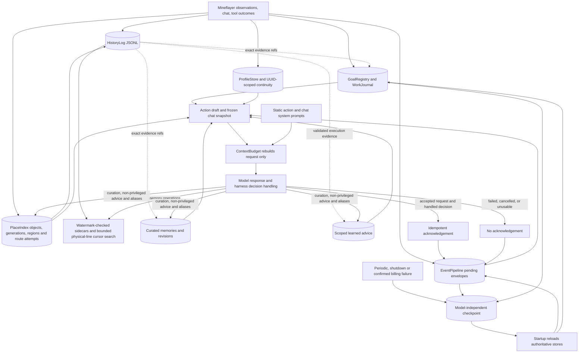

# ZincAI Architecture

This document describes how ZincAI boots, perceives the world, arbitrates body control between reflexes and the LLM, executes tools, persists state, and logs session telemetry.

---

## 1. Process & Session Topology

```text
Supervisor (zincai/supervisor.js)          [optional; disable with ZINCAI_NO_SUPERVISOR=1]
  └── Worker Process (zincai/index.js)
        ├── RuntimeConfig (runtime_config.js)       # 10 live operator parameters
        ├── ConnectionManager (connection.js)       # DISCONNECTED/CONNECTING/CONNECTED/RECONNECTING
        ├── PhysicalBoundary (boundary.js)          # lifecycle + anti-flood guard (19 bot primitives)
        ├── Host (host.js + control_commands.js)    # stdin console command router & lifecycle owner
        ├── TelemetryRecorder (telemetry.js)        # data/sessions/<id>/{events.jsonl,continuation.json}
        ├── Persistent Stores (data/*.json)         # goals, memories, continuity, journal, places, circuits
        └── Active Session (startSession)
              ├── Mineflayer Bot + ProtocolKeepalive + VanillaGuard + PhysicalGuard
              ├── ControlArbiter (control.js)       # priority lanes: survival > combat > task > idle
              ├── System1 (system1.js) + ThreatSense (threats.js) + EscapePlanner (escape.js)
              ├── ArmorKeeper (armor.js) + AdvancedCombat (src/combat.js)
              ├── PathfinderWrapper + Skills + BuilderExecutor + RedstoneEngineer
              └── Brain (brain.js) + ApiWrapper (api_wrapper.js) + Lanes (lanes.js)
```

`zincai/index.js` separates **process-scoped state** (`makeShared` + `createHost`) from **connection-scoped state** (`startSession`). When the operator runs `leave`, `join`, or `restart-connection` — or when the server restarts — `Host` disposes the Mineflayer session and spawns a new one while preserving goals, memory, continuity, journal, telemetry, and runtime config across reconnects.

---

## 2. Two-Lane Model Architecture

The LLM layer (`brain.js`, `api_wrapper.js`, `lanes.js`, `src/amdClient.js`) splits conversation and embodied action into two independent lanes sharing a unified token-bucket rate limiter (`inference.rpm`, default 18/min, with `inference.chatReserve` = 4 reserved for chat):

### Chat Lane
- Collects incoming player chat and whispers into an IRC-style chronological window (`irc.js`, batch window `inference.chatBatchMs`, default 6s).
- Never drops lines via heuristic relevance scoring and never enforces language filters.
- Uses `chat_prompt.txt` and returns a structured JSON decision (`reply`, optional `to` whisper target, optional `remember` fact, optional immediate `do` such as `come`/`follow`/`stop`, and optional `task` handoff for the action lane).
- Runs concurrently with ongoing walking, gathering, or building so conversation never stalls waiting for a physical task.

### Action Lane
- Uses `system_prompt.txt` plus the live world snapshot (`perception.js`, `observe.js`, block-derived `environment.js`), IRC timeline, threat summary (`tactics.js`), open goals (`goals.js`), active plan digest (`journal.js`), and one budgeted memory block (dossiers of the players present, curated recall for the goal/position/request, and a short `past attempts (raw log)` warning). House/site preflight lives in `build_site.js`; failed repeated calls are tracked by `failgate.js`.
- **Ends every turn with a `your move:` frame** (`nextmove.js`): what just happened or what is blocked, then 2–4 concrete moves that are available *now*, each with the reason it is available. It is derived only from live state (inventory, position, nearby index, plan, failures) and never invents an option. This is what makes each turn a question rather than a snapshot — see `docs/INCIDENT-2026-11-17-inventory-loop.md` for the session that motivated it. Disable with `DECISION_FRAME=0` (or `decisionFrame: false`).
- **Plan steps can end.** `journal.js` counts attempts per step, and after two failures of the tool that advances a step it renders as `⊘ blocked` with the reason instead of `→ do this now`; `goal {operation:"replan", drop:[n], next:"…"}` retires a dead step in one call and keeps the reason. A `next` note is invalidated when the plan is known to be broken, so a stale note cannot outlive the world that made it.
- Exposes all **44 function tools** identically on every call (`ACTION_TOOLS` in `api_wrapper.js`) so prompt prefix caching stays warm.
- Executes multi-step tool loops (`think → tool calls → tool outputs → think`) up to `inference.maxStepsPerTurn` (default 6).
- A successful **read-only** result only buys its own model call when it is news: if the same subject has been read twice already and the answer is unchanged, the result stays in `results` but does not wake the model. Reads that changed always wake it.
- Extracts and records `reasoning` (`reasoning_content` / `reasoning` / `<think>`) alongside tool calls and token usage in session telemetry.
- Uses a `situationVersion` counter so stale decisions formed before a sudden reflex interrupt (damage, flee start, death) are discarded instead of executing outdated actions.

---

## 2b. Memory Architecture

Memory distinguishes evidence, current projections, curated beliefs, and prompt context.
Persistent paths below are relative to `ZINC_DATA_DIR`.

| Layer | Store | Access |
| --- | --- | --- |
| Raw evidence | `history/<category>/<day>.jsonl` and rebuildable `.idx.json` keyword sidecars | `memory history` by exact ref or cursor; short past-attempt excerpts may be selected automatically |
| Diagnostics | `sessions/<id>/events.jsonl`, screenshots and `continuation.json` | Telemetry; not a replacement for raw search |
| Curated beliefs | `memories.json`: scope, status, evidence, confidence, revisions | strict `memory search` and `read`; automatic recall remains bounded and relevance-based |
| People and social context | `entities/*.json`, `continuity.json`, `conversations.json`, `preferences.json` | UUID dossiers and new runtime UUID-keyed social records; provisional and legacy name records kept separate |
| World projection | `places.json`: points, object generations and tombstones, estimated boundaries and route attempts | `memory objects`, `alias`, `region`, `regions`, `routes`, plus current skills and storage lookup |
| Learning | `learned-rules.json`: scoped agent advice with tool evidence and revisions | `memory learn`, `rules`, `retire`; at most two applicable rules in dynamic action context |
| Delivery and recovery | `events-journal.json`, `goals.json`, `journal.json`, `memory-checkpoint.json`, `lifecycle.json` | operational state; oldest evidence remains independently searchable |



### Retrieval and persistence details

- **Raw history:** new rows carry random record IDs, byte offsets, physical line refs and `repeatOf` where applicable. A bad or stale sidecar can cost I/O, not hide a record. History pages report files/records/bytes scanned, incomplete coverage, and a cursor; page ordering is deterministic by file traversal, with relevance ranking within the page. Continue with the same filters. The cursor is not a multi-process snapshot. `HistoryLog.rebuildIndex(file)` can recreate sidecars. Maintenance only previews age-based pruning; it does not remove history.
- **Curated search:** category, identity/profile, subject, object, goal, mode/status, dimension/world, estimated region, radius/elevation, confidence, and observation or creation range constrain candidates before ranking. Match reasons and evidence are shown. Similarity suggests duplicate candidates; automatic maintenance merges only exact text in matching scopes. Prior curated revisions are available via `memory read` with `revision`. Historical and include-stale modes can include nonactive rows; current curated results are *active beliefs*, not live verification.
- **Objects:** block updates and loaded-world verification maintain presence; unknown/unloaded is not removal. On confirmed replacement the projection allocates a new generation instead of transferring label or stock. Agent aliases do not rename blocks. Inventory observations and removals are appended as structured evidence. Successful bed use is recorded separately, with spawn status unknown. Configure `ZINC_WORLD_ID` for a stable logical world identifier when host/port is insufficient; use separate data directories for different worlds.
- **Spatial:** estimated inclusive XYZ boxes support off-center containment, nested room candidates, and object filters. They do not prove connectivity or access. Named points remain waypoints. Route attempt evidence records success/failure and reason, never a promise of a live path. No automatic interior graph, authoritative spawn detection, or persistent path-distance cache is inferred.
- **Delivery:** draft assembly does not acknowledge events. Action acknowledgements are limited to the successful request's actual prompt and made after decision handling. Chat lines carry durable envelope IDs; a failed chat can be replayed, and the IRC cursor advances only after handling the frozen snapshot. Durable unacknowledged events are not evicted at the old 64-record limit. This is **at-least-once recovery**: a crash after a Minecraft side effect but before its receipt can require live reconciliation.
- **Checkpoints:** `memory-checkpoint.json` records the reason, open goals, pending IDs, working survival snapshot and recent conversation fragments (target five exchanges, `ZINC_CHECKPOINT_EXCHANGES`). It does not replace authoritative stores. HTTP 402 or explicit supported billing codes latch inference and checkpoint without another model call; generic 429/network/auth failures do not latch billing. Restart reloads journals and goals; there is no autonomous consolidation-job replay yet.
- **Compaction and advice:** request compaction does not run durable maintenance. WorkJournal keeps bounded evidence locators and progress headlines, not full inventory detail; follow the original refs. Learned advice is scoped by objective/world/dimension, tied to matching execution evidence, and rendered as data, never as a new system message.

---

## 3. Body Arbitration & Survival Reflexes

All physical actuators flow through **`ControlArbiter`** (`zincai/control.js`), which guarantees that only the highest-priority active lane drives movement and hand inputs at any tick:

| Priority | Lane | Owner |
| --- | --- | --- |
| Highest | `survival` | `System1` reflexes (flee, hazard escape, eat, water clutch, elytra recovery) |
| High | `combat` | `AdvancedCombat` (`src/combat.js`) when the model explicitly calls `attack` |
| Normal | `task` | `Skills`, `BuilderExecutor`, `RedstoneEngineer`, `PathfinderWrapper` |
| Lowest | `idle` | `buoyancy` (keep head above water when idle) |

### Reflexes (`System1` + `ThreatSense` + `EscapePlanner`)
- `ThreatSense` (`threats.js`) classifies nearby entities into **threats** (line-of-sight hostiles within 12m, ranged within 18m, reachable close hostiles within 8m, lit creepers/TNT, or any entity that damaged ZincAI in the last 15s), **watch** (open hostiles out to 32m), and **hidden** (blocked behind walls/bars). Protected entities (villagers, tamed pets, named mobs, decor) are never targeted.
- When a threat enters the trigger ring, `System1` runs a deterministic node-bounded BFS over walkable terrain (`custom_mineflayer/escape.js`), comparing bot arrival time against pursuer arrival time per cell, and commits to the safest reachable destination (`open`, `pocket`, `chased`, `surrounded`, or `trapped`).
- The reflex wakes the model with exact episode telemetry and a vanilla gear fight estimate (`tactics.js`). The model remains in control: `idle` continues fleeing, `attack` switches to explicit combat, `go_to`/`follow` redirects movement, and `hold` suppresses fleeing from those listed threats.

### Physical & Vanilla Guards
- **`installVanillaGuard`** (`vanilla_guard.js`) wraps `bot.chat` (deferring cleanly to `inject_allowed` on real Mineflayer bots) so slash commands (`/...`) cannot leave the process, emitting `vanilla_command_blocked`. Guarded `/msg <onlinePlayer> <text>` whispers are the only exception.
- **`installPhysicalGuard`** (`boundary.js`) wraps 19 Mineflayer body primitives (`setControlState`, `clearControlStates`, `look`, `lookAt`, `dig`, `stopDigging`, `placeBlock`, `activateBlock`, `activateEntity`, `attack`, `swingArm`, `equip`, `unequip`, `toss`, `tossStack`, `consume`, `activateItem`, `deactivateItem`, `sleep`) and blocks them whenever the bot is paused, disconnected, dead, or over the anti-flood ceiling (`limits.maxPhysicalActionsPerMinute`).

---

## 4. World Interaction, Gathering, Building & Redstone

- **Perception (`perception.js`, `vision.js`, `places.js`, `block_inspect.js`, `region_inspect.js`)**: Reports grounded coordinates, block states, entities, inventory, remembered places, and optional `screenshot` views (`look`, `panorama`, `map`). `vision.js` now renders with the real client resource pipeline — blockstates → models → parents/multipart → real textures, vanilla render layers, shared depth buffer, real item/entity models with skins, and permanent fullbright — instead of procedural materials. See [`docs/native-renderer.md`](native-renderer.md) for the full design and limitations.
- **Navigation (`custom_mineflayer/pathfinder_wrapper.js`, `doors.js`)**: Wraps `mineflayer-pathfinder` with dynamic threat-cost penalties (40-tick predictive threat map), automatic door/gate handling, pillar/bridge traversal, and posture derived purely from the active action (never a mode).
- **Gathering & Skills (`skills.js`)**: Supports gathering any diggable vanilla block (`gather { item, count?, radius? }`), crafting via `prismarine-recipe` (`src/recipes.js`), smelting, container I/O (`look_in`/`take`/`put`), sleeping, lighting, sheltering, and corpse runs. Only truly unbreakable blocks (`UNGATHERABLE_BLOCKS`, e.g. `bedrock`, `barrier`, `end_portal_frame`) are excluded.
- **Building (`builder.js`)**: Executes inline grid blueprints (`build`) and parametric shapes (`build_shape`: `wall`, `floor`, `box`, `tower`, `roof`, `stairs`, `bridge`, etc.) with ground-truth block verification.
- **Redstone & Logic (`redstone_inspect.js`, `redstone_engine.js`, `logic_test.js`, `circuit_projects.js`)**:
  - `redstone_scan` & `redstone_component` capture honest static block-state snapshots without fabricating unverified power flow.
  - `redstone_engineer` provides circuit analysis (with explicit model-vs-world diffs and fault diagnosis), built-in & learned designs, material-aware placement (mapping block names like `redstone_wire` to inventory items like `redstone`), and live functional verification (`verify`).
  - `logic_test` evaluates abstract Boolean gate truth tables and saves them into `circuit_projects.json`.

---

## 5. Telemetry & Continuation State (`data/`)

`TelemetryRecorder` (`zincai/telemetry.js`) writes all session artifacts under `<dataDir>/sessions/<sessionId>/` and updates `<dataDir>/latest.json`:

1. **`events.jsonl`** — Append-only NDJSON where each record has `{ seq, ts, ms, sessionId, type, data }`. Event types:
   - `session_start`, `session_end`
   - `lifecycle` (`spawn`, `death`, `respawn`)
   - `world_event`, `reflex_event`, `combat_event`, `goal_event`
   - `chat_in`, `chat_out`
   - `model_request`, `model_response` (including verbatim `reasoning`, `actions`, `reply`, `usage`, `ms`, `finishReason`)
   - `tool_exec`, `operator_command`, `error`
2. **`continuation.json`** — Periodically and atomically updated snapshot containing `schemaVersion`, `sessionId`, `status`, `botState` (connection, health, food, position, dimension, inventory, recent chat), `activeGoal`, `openGoals` (all non-terminal goals including `resumable`), `plan`, `journalDigest`, `lastModelRequest`, `lastModelThought`, `recentTools`, `recentEvents`, and aggregate `stats`.

---

## 6. Real-Server Simulation Testing

`test/` verifies ZincAI end-to-end against real `flying-squid` 1.21.4 servers:
- `test/helpers/mc-server.js` boots an ephemeral in-memory 1.21.4 server on a free localhost port with a 1.21.4 protocol bridge for respawn, player entity spawning, and movement relaying, plus helpers for blocks, inventories, health/damage/death, mobs, and real secondary Mineflayer clients (`Alice`).
- `test/helpers/fake-world.js` builds offline prismarine-chunk scenes for the native-renderer regression suites (`test/10`, `test/11`).
- `test/helpers/sim-harness.js` wires a local OpenAI-compatible HTTP server (`startScriptedLlmServer`) returning deterministic scripted tool calls, chat replies, and `reasoning_content` directly into `makeShared` + `createHost` + `startSession`.
