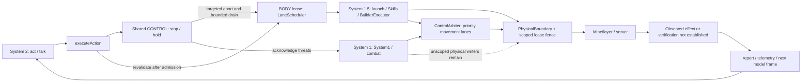
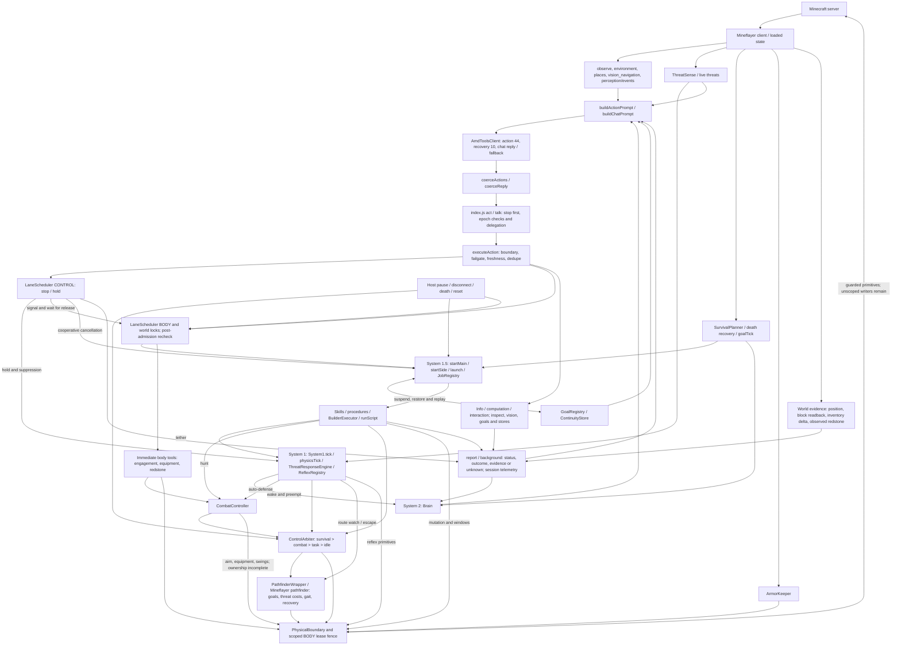

# Body control audit · `732adfb`

**Verdict:** The harness can translate some intentions into verified effects, but neither BODY admission nor the movement arbiter constitutes exclusive ownership of the whole avatar. The highest-priority problems are cancellation ordering, unenforced ownership outside key/goal writes, and reporting that sometimes treats a request or primitive return as a completed effect. These are harness issues independent of model choice. This is a source audit with deterministic probes and existing integration evidence, not certification of all physical operations or a measurement of production model quality. The baseline audit did not modify runtime, schemas, prompts, or memory.

## Implementation update (based on main `f536808`, including memory PR #45)

This section supersedes the historical findings where noted below. It is a first implementation pass, **not universal controller arbitration**.

- `LaneScheduler` now admits `stop`/`hold` on a shared CONTROL plane, independent of BODY and ordinary interaction. A BODY lease carries an ID, resources, cancellation signal and last guarded progress time. Targeted `stop` rejects a nonmatching ID without touching the current task; valid stop drops queued BODY requests, signals the active lease, requests cooperative skill/builder/combat/dig cancellation, and waits up to two seconds for lease release. The result is `cleanup_confirmed` or `cancelling`; confirmation concerns task/fight cleanup, not survival or inertial movement. BODY is not forcibly granted to another caller on timeout. Model batches execute stop first and skip subsequent BODY requests if cleanup remains pending. Existing survival priorities are unchanged.
- Physical guard consults the active asynchronous BODY lease for scoped task mutations. Released scopes cannot continue using guarded primitives. Cancelled scopes permit the limited dig/equip/key cleanup paths; this is **not** a fine-grained permission or universal acquisition requirement. Unscoped reflex, combat tick, gait, pathfinder, and armor paths still need an explicit common resource policy. No automatic lease expiry is implemented; reclaiming a lease without fencing its writers would be unsafe.
- BODY dispatch rechecks generation, life, dimension and existing staleness predicates after admission. `use_block` approaches the exact guarded target and rechecks state, dimension, authorization and current lane before activation. This does not yet cover every target or mutation. `mine_resource` rechecks block state, property guard and held pickaxe before digging; it counts client-observed broken blocks and separately reports inventory deltas and remaining block count. Drop provenance and exact per-block yields are not assumed.
- Bundled scripts return typed domain outcomes. Flee does not infer safety and tower height does not verify the whole structure. Goal completion no longer follows an explicitly `unverified` procedure return. The prompt distinguishes plan, request, execution and verification. Most existing tools still use legacy text and conservative `not_established` metadata until an effect oracle is implemented.
- `tool_request`, `tool_admission`, `body_cancellation_requested` and `action_outcome` augment session telemetry with raw action arguments, normalized public arguments, provider call IDs, BODY lease IDs, outcome fields and available evidence. This does not capture every primitive or establish production effectiveness; chat and autonomous correlation remain incomplete.
- New flying-squid tests exercise active walk/hold/targeted stop, same-reply stop and movement ordering, and script domain failure. Scripted model responses are not live AMD model validation. Two local navigation cancellations were observed at roughly 50–110 ms by log timestamps; this is anecdotal, not a before/after distribution. See `scripts/audits/check-tool-contracts.cjs` for expanded contract probes.

### Implemented control-path delta

The remainder of this document preserves the pre-implementation architecture and findings for comparison. The JSON artifact now snapshots the updated wire contracts.

## Baseline architecture and findings (`732adfb`)

| Layer | Input and decision | Actuation, lifecycle and state |
|---|---|---|
| System 1 (`system1.js`, `ThreatSense`, `ThreatResponseEngine`, `ReflexRegistry`) | Live entities/LOS, HP, hunger, motion, terrain, recent attacker data, objective tether, acknowledgments. Hazard escape first; AVOID/ENGAGE/FLEE; then food/health/buoyancy. Physics callbacks handle impacts, projectiles and long falls. | Default 200 ms interval plus physics callbacks. Survival movement preempts combat/task; buoyancy is idle priority. Can start auto-defense, use water/elytra, consume food. Emits episodes, wake/preempt and threat hints. Holds, cooldowns and flee state are volatile. Async interval errors may be swallowed or callbacks overlap. |
| Combat (`src/combat.js`) | Live target resolution, 3D range, relative motion, weapons and shield; approach, melee, bow, creeper retreat/strafe. Auto FLEE can disengage auto-defense; PvP requires explicit request and policy. | Combat lane moves; separate aim/equip/attack/use writes. Target and cooldown volatile. Kill versus disappearance matters. System 1 passes a selected threat's type to engage, not a bound entity identity. |
| System 1.5 (`index.js` agenda, `Skills`, `procedures`, `BuilderExecutor`, `LaneScheduler`) | Resolves goals, live targets, paths, inventory and block prerequisites; handles navigation, placements, harvest, loot and recovery. Two-second `SurvivalPlanner` monitor can run urgent food/hunt and suggest routine upkeep. Goal ticks and death recovery can schedule without LLM. | `startMain`/`startSide`/`launch`, promise-based lease handoff, skill token and builder cancellation. Jobs track builds, not all procedures. Durable goal detail, origins and continuation survive; pending promises and movement don't. Side-job resume replays a closure; not equivalent to remaining-work resumption. Errors become result text, some cleanup is best effort. |
| System 2 (`Brain`, `AmdToolsClient`, `act`/`talk`) | Receives compacted observations, chat, goals, outcomes and tool definitions. Budgets, debounces and preempts requests. Returns tool requests, not physical commands. | Action lane 44 or recovery subset 10; chat `reply` or prose fallback. Tool calls ordered, later BODY calls may be skipped. Chat can follow/come/stop independently or propose action-lane tasks. Decision/life epochs reject some late replies. Durable objectives and selected outcomes persist. |
| Movement and boundary (`ControlArbiter`, `PathfinderWrapper`, `PhysicalBoundary`) | Atomic scheduler resources include BODY/world conflicts and concurrent reads; movement arbiter separately selects survival > combat > task > idle, with volatile key/goal intents and TTLs. Pathfinder handles threat costs, soft terrain and digging windows, gait and recovery. | The original guard checked lifecycle/rate, not lease generation. Hand lock only covers participants. Guard installs on plugin initialization. Operator pause, model stop, death/reset and disconnect have different behavior. Vanilla chat guard prevents commands except guarded whispers. |

Baseline execution: parse/coerce → vanilla/lifecycle/fail-repeat checks → limited stale and duplicate checks → lease → handler/main/side → Mineflayer → local evidence or acknowledgment → `report`/`background` → model results/reawaken. Walk polls around 150 ms, waits through preemption and can replay goals/retry no-path; active walking budget does not bound preemption wall time. There was no unified action ID/state/cancellation barrier across provider calls, continuity actions, jobs, skill tokens and lease owners.

### Baseline failure analysis

- **Confirmed scheduler fault:** `stop` and `hold` used BODY. A `go_to` lease excludes both and the generic replacement path cancels the task before `hold` acknowledges threats. Same-answer `stop` can be skipped. Observations of live incident frequency were unavailable.
- **Confirmed ownership gaps:** combat can continue after dispatch lease release; armor, scaffold jump, gait/recovery, aim, window transactions and some equipment operations do not share one fence. A stale control timeout or hand restoration can race a newer writer. Event-timed reproduction is required to quantify impact.
- **Freshness gap:** `QUIET_TASKS` checks only active goal/new threats, before waiting. `use_block` guarded one search, repeated it, then clicked whatever was present after approach. Target mutation, dimension and goal revisions were not uniformly checked.
- **Reporting gap:** script sentinel failures become `ok`; follow/shelter cancellation can also be `ok`. Furnace loading, attack engagement, tossing and right-click are not the respective final effects. Some primitives return normally when refused. Stronger examples are build readback, arrival predicates and mining deltas, all limited to client observation.
- **Schema gap:** shallow parser checks types, extra/missing fields, and some array constraints; it normalizes enums, passes invalid non-strict enums through and does not enforce recursive schemas or semantic ranges. Empty `go_to`, radius 99, bogus gait and negative take count passed parsing. JSON aliases `move`, `say.t`, `craft.i`, `attack.n`, and leaked XML are fallback formats, not additional registered tools.
- **Persistence/duplicate gap:** duplicate main actions and repeated failures are filtered, not uncertain-success transactions. Resuming preserves selected checkpoints, not an idempotent remaining-work ledger; already applied inventory/world effects can persist through cancellation.

### Data and coordinates

`buildActionPrompt`/`buildChatPrompt` compose client pose/dimension, orientation, health/food, bounded inventory and durability, nearby entities, threat IDs, terrain/context, motion/route hints, goal and current activity, outcomes and compacted memory/events. Prompt sections are not atomic or uniformly timestamped. Events distinguish occurrence and observation time; other sections can be compacted away. `doingLine` and monitor `bodyBusy` are summaries, not ownership fences. Chat has less information than action.

Coordinates are absolute world blocks (`Vec3` for block lookups); continuous position is distinct from integer cells. `GoalNearXZ` ignores height; 3D GoalNear accepts proximity, not an exact cell. Build origins are minimum world corners, rows +X, layers +Y, columns +Z. Numeric session entity IDs, player names/UUIDs, registry block and item names, local container IDs, saved place names and redstone snapshot IDs are distinct. Threat range can be horizontal plus vertical bounds; approach often uses 3D distance. Cached container contents, threat scoring and pathability guesses are not live guarantees. Loaded client state can verify observed effects but cannot prove unseen activity or causality of every inventory gain.

### Tool inventory and documentation baseline

[Original exact schemas and descriptions](body-tool-contracts.baseline.json) capture all 45 unique functions and the recovery subset verbatim. [Updated export](body-tool-contracts.json) is checked against runtime. Every action passes through `index.js:executeAction` unless indicated. The final column describes the model-facing contract the audit recommended, including limitations not yet implemented uniformly.

| Tool | Baseline implementation / actual result | Correct contract or clarification |
|---|---|---|
| `say` | `speak`, public/guarded whisper | Request chat send; requires text, optional online recipient, no delivery receipt. |
| `go_to` | `Skills.goTo`, visible player > place > coords, path/cache/predicate | Start navigation to one target; x/z ignores Y; explicit Y uses nearby 3D cell and may retry wider. Soft terrain can change; return actual pose, not destination alone. |
| `dig` | `Skills.dig`, temporary pathfinder dig window/materials/avoid | Deliberate excavation toward reachable destination, not vertical shaft or loot collection. Ownership/dig rules; report partial break effects. |
| `follow` | `Skills.follow`, live player, last-seen recovery, ~45 s lost/~60 s no-path | Continuous procedure; not arrival; separate cancelled from completed. |
| `pace` | `PathfinderWrapper.setGait`/`jumpOnce` | Adjust gait or request a jump; physical motion not guaranteed, may be skipped. |
| `stop` | `replaceTask`, suspend goal, temporary auto-fight suppression | Request task/fight stop, not operator pause. Cleanup and survival movement are distinct. |
| `goal` | `runGoalOp`, durable `GoalRegistry` | Add/update/replan is intent; selected modes resume work or verify supported evidence, which can be unknown. |
| `attack` | `CombatController.engage` then live ticks; count bounded, player policy | Mob name/type, not runtime ID; player explicit. Start is not kill/loot; can preempt work. |
| `hold` | `System1.acknowledge`, live/snapshot IDs and bounded suppression | Acknowledge listed runtime threat IDs without cancelling current task; danger can override. |
| `look_in` | `Skills.lookIn` → open/walk/cache | Occupies body; ID/label or nearest reachable, report observed contents, not a future guarantee. |
| `take` | `Skills.take`, matching item and indexed container | Ordinary defaults all/clamps; furnace takes whole matching output, ignores count. Transfer is not just request. |
| `put` | `Skills.put`, walk/open/deposit | Up to carried quantity or all; reachable storage and capacity; not furnace input. |
| `smelt` | `Skills.smelt`, fuel then input slots | Furnace loading only; partial fuel/input changes can remain; collect separately. |
| `sleep` | `Skills.sleep`, nearest indexed bed and server sleep call | Requires reachable eligible bed; server can reject conditions; no world-time guarantee. |
| `give` | `Skills.give`, live player/dynamic approach then toss | Default one, clamped carried amount; no proof of receipt. |
| `eat` | `Skills.eat` → `useHand`/consume | Carried food or survival choice; can be full/busy; consumption is not guaranteed healing. |
| `equip` | `Skills.equip`/`ArmorKeeper` | Carried name, natural slot or explicit; none requires removable non-main-hand slot, interacts with auto armor. |
| `use_block` | `previewUseBlockTarget`/`Skills.useBlock` | Loaded nearest name/family within 16, approach and right-click; verify target and report effect separately. |
| `inspect_block` | `block_inspect.inspectBlock`, world integer cell | Loaded current dimension only; unknown is not air, no power inference. |
| `inspect_region` | `region_inspect.inspectRegion`, radius 0–2 default 1/page | Non-atomic paginated snapshot, no chunk loading or connectivity claims. |
| `redstone_scan` | `RedstoneInspector.scan`, coordinate capture or snapshot/page | Bounded loaded static capture; session-local snapshot ID, not a live trace. |
| `redstone_component` | `RedstoneInspector.inspect` | Snapshot ID + exact cell; reads captured, not current state. |
| `screenshot` | `vision.screenshot`, render quota/view/direction/at/perspective | Loaded client rendering; may return text only, no proof of exact block/coordinate/reachability. |
| `find` | `Skills.find`/`PlaceIndex` | Loaded blocks or known/cached storage; not-found does not prove absence. |
| `remember_here` | `Skills.rememberHere` plus ownership/home checks | Save current dimension and position; persistent label, no movement or discovery. |
| `memory` | Memory facade/history/profile handlers | Operation-dependent record/dossier/history IDs; local read/write, not live evidence. |
| `note` | Continuity/memory, discoveries or interests | Store information; not independent evidence or action. |
| `social` | Relationship/proposal handlers | Inspect/update stance, not chat send or physical request execution. |
| `craft` | `Skills.craft`/`recipes.js`, table access or placement | Count requests output, default batch, consume carried ingredients; may walk and place table. |
| `gather` | `Skills.gather`, aliases, inventory/tool/ownership gates | Break nearby blocks; `item` here means block/alias. Count refers to blocks, not drops. |
| `mine_resource` | `procedures.mineResource`, wood/stone bootstrap, dig/pickup deltas | Count blocks, not item yield. Higher tools must be carried. Report observed break and loot separately. |
| `hunt_and_loot` | `procedures.huntAndLoot`, protected-target exclusion and loot checks | Eligible reachable mob, one or bounded number of kills; kill does not guarantee loot gain. |
| `prepare_food` | `procedures.prepareFood`, bread/furnace, optional eat | Requires supported ingredients/station/fuel, can walk/place/wait; partial food outcome possible. |
| `light_up` | `Skills.lightUp`, carried torches, radius 2–16/default 8, bounded placements | May walk; no candidates is no-op, not a verified secure area. Placement return may lack readback. |
| `shelter` | `Skills.shelter`/`BuilderExecutor.pillarUpTo`, ~4 scaffold blocks | Pillar, not enclosed shelter. Wait until cancelled; best-effort descent, ranged dangers remain. |
| `corpse_run` | `Skills.corpseRun`, same-dimension death place, item entities ≤10 blocks | Observe nearby stacks on arrival; no verified recovery or despawn claim. |
| `logic_test` | `logic_test.testLogic`, optional circuit/project writes | Abstract acyclic combinational graph, not live circuitry or timing. |
| `redstone_engineer` | `RedstoneEngineer.act`, operations with differing lane policies | Place/verify mutate or toggle and may move. Simulation/design and static scans do not verify function. |
| `recall` | `memory.longTerm.retrieve` | Ranked recorded evidence, same-dimension location filter expects all three coordinates. |
| `circuit_project` | `CircuitProjectStore.act` | Bind/show saved snapshot or run abstract test; no live effects. |
| `build` | `BlueprintParser`/`buildBlocks`/`BuilderExecutor` | Staged world mutation, minimum corner, carried mapped materials and support; verify exact placed/remaining counts. |
| `build_shape` | `generateShape` then same builder | Shape-specific params/defaults, stage and absolute origin; not a preview, partial work persists. |
| `run_script` | `reflex_registry.js:runScript` bundled `flee` and `build_tower` | Non-resumable local procedure, not shell/code or generic cancellation. Domain outcome distinct from JS return. |
| `idle` | End planning turn | No change to task or survival state. |
| `reply` | `coerceReply` → `talk` | Social reply; strict `do=follow/come/stop` can act and interrupt. `task` delegates a proposal, no execution confirmation. |

Gaps include general exact-coordinate activation, pickup by entity ID, arbitrary slot transfer/inspection, wake, cross-dimension route, and generic model progress query. `build` can express single-block placement. `find` searches cached contents; `look_in` opens and reads. `dig`, `gather` and `mine_resource` solve different problems. No lane alias is evidence of tool registration.

### Tests, diagnosis and remediation baseline

Baseline: `npm ci`, syntax, dry-run and **132/132** existing tests passed (168.30 s); independent 14/15/16 run **34/34** (23.65 s); 48 registry/dispatch/validation/contention probes. Full-suite stdout had 47 `action:` lines across 25 labels, not offer/selection/acceptance denominators. Real server proved specific flee, navigation, placement, mining/pickup and hunt scenarios, not every contract. No live AMD decisions or production latency/rate evidence.

For each tool snapshot wire exposure, minimally valid args and defaults, reject invalid and boundary cases or document clamp, compare dispatcher arguments, and test no-op/reject/partial/verified/unverifiable outcomes. Use real world oracles for pose, drop/inventory/slot and container deltas, block readback, sleep, entity kills versus despawns, actual toss versus receipt, image fallback and redstone transitions. Use pure parser/lease checks for deterministic mechanics. Force threat arrival during movement/mutation, pause and resume, replacement target, dimension change, no path, delayed model, duplicate retries after partial effects and controller failure. Validate release and absence of late writes, not only the tool's return.

Attribute misses to the earliest supported stage: available tool not selected; wrong selection; invalid arguments; misleading contract; stale/missing data; valid request refused at dispatch; controller contention; physical failure; effect unmet; wrong verification/report. Expected policy rejection is separate. Instrument offer/attempt/admission/start/preempt/resume/cancel/drain/verify/deliver with monotonic timestamps, attempt + lease + goal IDs and evidence; compute per-stage denominators, p50/p95 and censored incomplete attempts. Never infer selection quality from a failed primitive or measure success by dividing unrelated log lines.

| Priority | Remediation | Impact / effort |
|---|---|---|
| P0 | Independent control admission and explicit request versus drain acknowledgment | High / medium, implemented for scoped model stops |
| P0 | Fence every movement, camera, hand/window and world writer; safe compatibility/preemption | High / high, partial scope implemented |
| P1 | Correlated lifecycle/evidence, post-admission and pre-mutation revalidation, replay-safe remaining work | High / medium–high, partial |
| P1 | Per-tool semantic contract and world-oracle coverage; measure before tuning policy | High / medium–high, pending broad coverage |
| P2 | Timestamped action frame and deterministic procedure expansion as telemetry justifies | Medium / medium, pending |

### Complete runtime control architecture (implementation branch)

