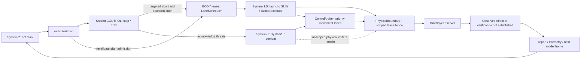

# Body control audit · `732adfb`

**Verdict:** The harness can translate some intentions into verified effects, but neither BODY admission nor the movement arbiter constitutes exclusive ownership of the whole avatar. The highest-priority problems are cancellation ordering, unenforced ownership outside key/goal writes, and reporting that sometimes treats a request or primitive return as a completed effect. These are harness issues independent of model choice. This is a source audit with deterministic probes and existing integration evidence, not certification of all physical operations or a measurement of production model quality. No runtime, schema, prompt, or memory changes were made.

## Implementation update (based on main `f536808`, including memory PR #45)

This section supersedes the historical findings where noted below. It is a first implementation pass, **not universal controller arbitration**.

- `LaneScheduler` now admits `stop`/`hold` on a shared CONTROL plane, independent of BODY and ordinary interaction. A BODY lease carries an ID, resources, cancellation signal and last guarded progress time. Targeted `stop` rejects a nonmatching ID without touching the current task; valid stop drops queued BODY requests, signals the active lease, requests cooperative skill/builder/combat/dig cancellation, and waits up to two seconds for lease release. The result is `cleanup_confirmed` or `cancelling`; confirmation concerns task/fight cleanup, not survival or inertial movement. BODY is not forcibly granted to another caller on timeout. Model batches execute stop first and skip subsequent BODY requests if cleanup remains pending. Existing survival priorities are unchanged.
- Physical guard consults the active asynchronous BODY lease for scoped task mutations. Released scopes cannot continue using guarded primitives. Cancelled scopes permit the limited dig/equip/key cleanup paths; this is **not** a fine-grained permission or universal acquisition requirement. Unscoped reflex, combat tick, gait, pathfinder, and armor paths still need an explicit common resource policy. No automatic lease expiry is implemented; reclaiming a lease without fencing its writers would be unsafe.
- BODY dispatch rechecks generation, life, dimension and existing staleness predicates after admission. `use_block` approaches the exact guarded target and rechecks state, dimension, authorization and current lane before activation. This does not yet cover every target or mutation. `mine_resource` rechecks block state, property guard and held pickaxe before digging; it counts client-observed broken blocks and separately reports inventory deltas and remaining block count. Drop provenance and exact per-block yields are not assumed.
- Bundled scripts return typed domain outcomes. Flee does not infer safety and tower height does not verify the whole structure. Goal completion no longer follows an explicitly `unverified` procedure return. The prompt distinguishes plan, request, execution and verification. Most existing tools still use legacy text and conservative `not_established` metadata until an effect oracle is implemented.
- `tool_request`, `tool_admission`, `body_cancellation_requested` and `action_outcome` augment session telemetry with raw action arguments, normalized public arguments, provider call IDs, BODY lease IDs, outcome fields and available evidence. This does not capture every primitive or establish production effectiveness; chat and autonomous correlation remain incomplete.
- New flying-squid tests exercise active walk/hold/targeted stop, same-reply stop and movement ordering, and script domain failure. Scripted model responses are not live AMD model validation. Two local navigation cancellations were observed at roughly 50–110 ms by log timestamps; this is anecdotal, not a before/after distribution. See `scripts/audits/check-tool-contracts.cjs` for expanded contract probes.

### Implemented control-path delta

The remainder of this document preserves the pre-implementation architecture and findings for comparison. The JSON artifact now snapshots the updated wire contracts.

