# Navigation-centered intents: incremental migration in PR #46

`NavigationIntents` is a session-local contribution registry, not another actuator. New modules publish goals or spatial influences. Existing task, combat and survival drivers retain `ControlArbiter.Lane` as a compatibility adapter. The same arbiter selects one key/goal owner, and `PathfinderWrapper` computes and executes routes via Mineflayer. Module publication does not update durable objective progress.

## Model and locomotion flow

```mermaid
flowchart LR
  MC["Minecraft server"] <-->|positions, chunks, inputs| BOT["Mineflayer client"]
  BOT --> SENSE["ThreatSense / PredictiveThreatMap"]
  BOT --> CORE["PathfinderWrapper / A* / ControlArbiter"]
  CORE -->|keys and goals, physical guard| BOT
  SENSE -->|ellipses, predicted motion, pinch costs| CORE
  SENSE --> FAST["System 1: assess / avoid / escape"]
  FAST -->|existing survival lane| CORE
  PROC["System 1.5: Skills / BuilderExecutor / AdvancedCombat"] -->|existing task/combat lane| CORE
  PROC -->|equip, dig, click, attack through physical boundary| BOT
  MOD["Autonomous and model-assisted modules"] -->|goals, overrides, spatial influence| REG["NavigationIntents and selectIntent"]
  REG -->|same arbiter lanes and A* costs| CORE
  CORE -->|sampled pose / arrival| REG
  REG -->|read-only observation frame| MOD
  REG -->|intent outcome| EVT["EventPipeline / persistent durable-event journal"]
  MOD -->|requestDecision: normal or expedited| EVT
  FAST --> EVT
  PROC --> EVT
  EVT -->|ordered pending IDs| BRAIN["System 2 orchestration: Brain / buildActionPrompt"]
  BRAIN <-->|RPM-governed request and structured reply| LLM["AmdToolsClient / LLM"]
  BRAIN -->|usable response processed: acknowledge shown IDs| EVT
  BRAIN -->|executeAction: objective / tool dispatch| PROC
  BRAIN -->|CONTROL stop / hold| CORE
```

### Priority, constraints and migration

- New goal tiers: `opportunity` 0.5, `objective` 1, `override` 2, `urgent` 2.5, `safety` 3. They compete in the same resolver as compatibility lanes (task 1, combat 2, survival 3). Ties keep the earlier registered lane; this is predictable, not a utility optimizer. Modules choose a tier and can supply context-dependent activation/validity; overrides need a reason and finite expiry. A lower goal stays published and can resume after the override ends. Cancel/withdraw explicitly to discard it.
- `publishDanger` and `publishConstraint` currently share a dimension-scoped spatial contract: center in world blocks, radius, severity, expiry, optional `hard` and event/entity metadata. Multiple soft influences sum with radial falloff and a cap of 60 for contributed cost. Existing terrain, obstacle, and predictive hostile costs remain intact. Hard exclusions filter candidate destination cells in A* and trigger route re-evaluation if they intersect the watched path. A bot already inside a new zone may take outward steps to escape. They are **not** continuous collision boundaries: traversals, jumps, smoothing, and raw emergency keys need separate coverage. Use soft costs unless node exclusion is intended.
- System 1 retains its tested AVOID/ENGAGE/FLEE policy and no-model emergency escape, including the existing wall-aware creeper escape planner and direct recovery fallback. It now also sees registered locomotion objectives as a tether when no skill tether exists. Auto-defense binds to the sensed entity ID rather than silently selecting another mob of the same type. Soft danger does not create a flee goal. This change does **not** introduce a new fusing-creeper detector or rewrite melee/kiting.
- System 1.5 still uses existing pathfinder-backed approach and walk skills for mining, collection, building and interaction. Explicit combat still uses the compatibility combat lane, with the existing agenda suspend/replay behavior. Gait, scaffold, emergency movement and combat stance writes are **not all migrated**. No new hand/aim/window ownership or compatibility guarantees are implied.
- PR #46 CONTROL behavior is preserved. Untargeted model stop withdraws registered navigation goals as well as stopping task/combat work. Death removes module goals; session teardown unregisters modules and their constraints. The lifecycle boundary still governs motion. Module goal IDs are not BODY lease IDs; `stop.action_id` still addresses only an active BODY lease.

## Module development

Populate `shared.navigationModules` with trusted in-process definitions **before** starting a session, in dependency order. The session registers them after its controllers start. For live/test registration, use `session.internals().navigationIntents.register(definition, start)`. This is a developer interface, not an LLM tool or automatic plugin loader.

A definition declares `id`, `dependencies`, `purpose`, `inputs`, `outputs`, `capabilities`, whether it executes procedures, and `modelAssisted`. Metadata is descriptive; it is not a sandbox or an authorization grant. `start(port)` can return a synchronous cleanup function. `observe(frame, port)` gets a frozen sampled `{at, dim, position, health, food}` frame on the route watcher cadence. Keep callbacks small and synchronous; an exception unregisters the observer and its dependents. Inject a separate read-only sensor or approved procedure runner in the module factory if extra data or interactions are needed. No module needs to manage provider calls.

- `publishGoal(id, {goal, tier, dim, target, parentObjective, valid, complete, dynamic, expiresAt})`: `goal` is a Mineflayer pathfinder goal. `valid` may invalidate an intent before or during use. Static goals default to `goal.isEnd(flooredPosition)`; dynamic goals need a custom completion predicate or explicit withdrawal. `arrived` is a navigation result, not proof of an interaction, kill, or pickup.
- `publishOverride(id, {...goalSpec, reason, expiresAt})`: temporary by construction. Remove with `withdrawGoal`. Do not silently cancel another module's objective.
- `publishDanger` / `publishConstraint` / `withdrawZone`: use stable module-local IDs; refresh moving targets before expiry. A zone cannot issue movement by itself.
- `readState()`: dimension, winning owner, active locomotion contributors, goal metadata and zones. Completion/expiration/withdrawal is journaled as `navigation_intent_result`; a live module can receive it through `onResult(result, port)`. `unregister(id)` removes the publisher, its adapter lanes, goals and zones; dependent modules unregister too.
- `requestDecision({summary, eventType, where, entities, causalActId, expedited})`: only for a `modelAssisted` module. Returns the event sequence when recorded. Decisions come back through ordinary System 2 tools; there is no separate module callback channel from the LLM.

### Example patterns

1. **Autonomous danger:** [`hazardSite`](../zincai/navigation_modules/hazard_site.js) registers a temporary dimension-scoped exclusion without an LLM or bot handle. A mob sensor can use the same pattern to refresh a *soft* region keyed by the live entity ID and withdraw it on despawn.
2. **Model-assisted objective:** In an observer with `modelAssisted: true`, call `port.requestDecision({summary: 'Two routes to camp; the south bridge is blocked', entities: ['camp']})` once on the transition. Let System 2 choose a new goal; do not infer that recording the event changed the objective.
3. **Deterministic resource procedure:** Use `Skills.mineResource` through the existing scheduler for physical execution. It walks through the task lane, checks the block before digging and reports inventory evidence. A new procedure can publish a `GoalGetToBlock` with `parentObjective` and a `valid` predicate, then ask an injected scheduler-owned procedure to interact after arrival. Do not have an observer write to the bot directly or treat arrival as harvested loot.
4. **Hybrid:** Publish updated soft danger regions on observations. If avoidance repeatedly fails, call `requestDecision` once with threat IDs, route and objective; do not wait for the model to run emergency escape. Combat remains compatible with this pattern but its stance and approach implementation has not been replaced.

## Ordered model scheduling and durability

`EventPipeline.formatDecisionBatch` is the action prompt's single event frame. It orders by event sequence (record/discovery order, with original occurrence timestamps retained). Expedited module requests append first and call `Brain.wake(urgent: true)` without waiting for the regular module collection window (`events.batchWindowMs`). Existing critical wake sources get the same ordered frame. A bounded frame normally takes an oldest-first prefix; if it would omit the newest critical record, it reserves the last slot for that record. The omission count is explicit, and omitted IDs are not acknowledged. This is chronological **within each delivered frame**, not strict across all requests when a critical record jumps ahead of a deferred segment. Chat still uses its existing lane and acknowledgment path.

No RPM bypass was added. `Brain` retains its scheduling limits, backoff and chat reserve; `AmdToolsClient._waitForRateSlot` is the HTTP attempt gate, including retries. Expedited calls can still wait for an in-flight thought, a rate slot or backoff. Reading/building/compacting frames is not acknowledgement. `act` marks only the IDs in the accepted prompt after a usable processed response. Existing durability applies: important events survive restart; transient ambient eviction and the chat-specific buffer are unchanged. No absolute no-loss guarantee is made for ambient events. A remaining important backlog may schedule another bounded turn.

## Verification and next migration step

The new tests use isolated flying-squid 1.21.4 plus a scripted OpenAI-compatible provider. They cover an expiring override restoring a primary goal, A* travel around a restricted region, dependent module removal, and an expedited request containing earlier events. A pure event test covers overflow and acknowledgment of exact IDs. Existing memory delivery, survival and cancellation suites remain the baseline. There is no measured production RPM/latency or live AMD quality result from this migration.

Next, migrate individual direct locomotion paths (combat approach/spacing, then the sensitive emergency and gait paths) behind verified navigation primitives. Add evidence for moving multi-threat fields, exact target engagement/resumption, fusing-to-exploded creeper traces, and hard constraints during jumps before removing their compatibility paths. Do not conflate those follow-ups with the registry being available now.
